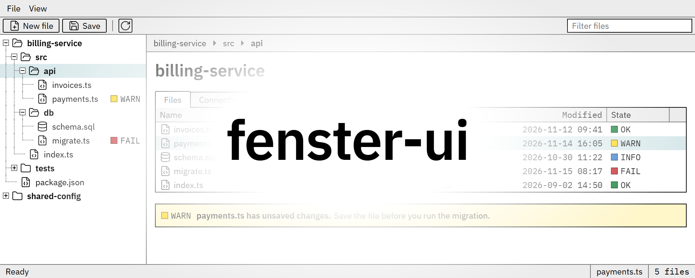

# fenster-ui

A compact desktop-style component framework on React Aria Components.

<a href="https://andreasfreund.github.io/fenster-ui/">
  <picture>
    <source media="(prefers-color-scheme: dark)" srcset=".github/readme-dark.png">
    
  </picture>
</a>

- [`packages/fenster-ui`](packages/fenster-ui): the library, published as
  [`@andreasfreund/fenster-ui`](https://www.npmjs.com/package/@andreasfreund/fenster-ui)
- [`apps/demo`](apps/demo): every component with live examples, deployed to
  [andreasfreund.github.io/fenster-ui](https://andreasfreund.github.io/fenster-ui/)

```sh
npm install
npm run build
npm run dev
```

## Releasing

Bump `version` in `packages/fenster-ui/package.json`, commit, then tag and push:

```sh
git tag v0.1.0 && git push origin v0.1.0
```

The release workflow publishes to npm with provenance.

## License

MIT
