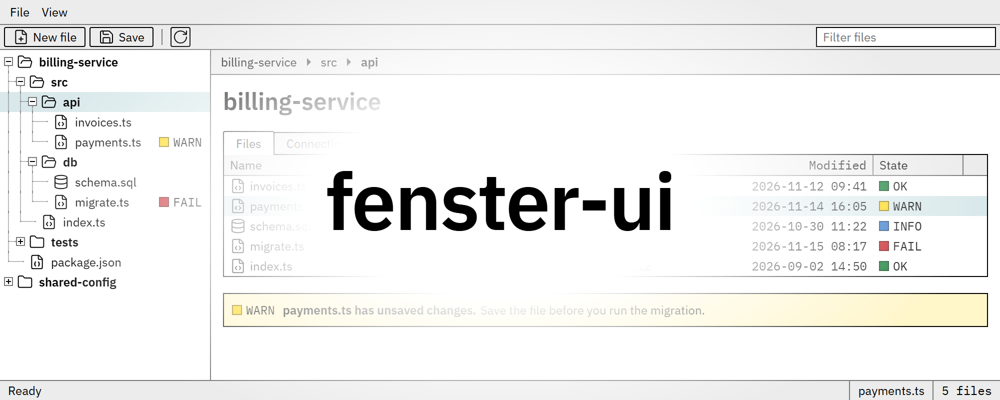

# fenster-ui

A compact desktop-style component framework on [React Aria Components](https://react-spectrum.adobe.com/react-aria/) 1.22.
React Aria provides behaviour, keyboard handling and accessibility; this package provides layout, look and a few
app-level helpers (commands, shortcuts, appearance).

<a href="https://andreasfreund.github.io/fenster-ui/"><picture>
  <source media="(prefers-color-scheme: dark)" srcset="https://raw.githubusercontent.com/AndreasFreund/fenster-ui/main/.github/readme-dark.png">
  
</picture></a>

## Install

```sh
npm install @andreasfreund/fenster-ui react-aria-components react-aria
```

Apps that bundle with Vite should dedupe `react`, `react-dom`, `react-aria` and `react-aria-components`, so the app
and the framework share one copy. The [demo](https://andreasfreund.github.io/fenster-ui/) shows every component.

Peer dependencies: `react` and `react-dom` 19, `react-aria` and `react-aria-components` ^1.22.

```tsx
import '@andreasfreund/fenster-ui/style.css';
import '@andreasfreund/fenster-ui/fonts.css';
import { AppFrame, LabelsProvider, initAppearance } from '@andreasfreund/fenster-ui';

initAppearance(); // before the first render

root.render(
  <LabelsProvider labels={{ invalid: 'FAIL' }}>
    <AppFrame>…</AppFrame>
  </LabelsProvider>
);
```

## Theme, density and accent

| Attribute | Values | Default |
|---|---|---|
| `data-theme` | `light`, `dark` | follows the OS |
| `data-density` | `comfortable` | compact |

Set them on `<html>`, or on an `AppFrame` / `Root`: overlays opened inside a frame render inside it and inherit both.

The appearance API stores the user's choice in `localStorage` and applies it:
`loadAppearance`, `saveAppearance`, `applyAppearance`, `initAppearance`, `forcedAppearance`, `resolveAccent`, `ACCENT_PRESETS`.
An app sets its own defaults for users who have saved nothing with `initAppearance({ theme: 'light', density: 'comfortable' })`.
A second argument forces parts for every user, whatever they saved, such as a brand accent:
`initAppearance({}, { accent: { kind: 'custom', color: '#b0005a' } })`. Forced parts are never written over the user's
own choice, and `forcedAppearance()` returns them so a settings dialog can leave out their controls.
An appearance is `{ theme: 'system' | 'light' | 'dark', accent, density: 'compact' | 'comfortable' }`, where `accent` is
a preset id or a custom colour. Presets have ids and colours; the app names them. A custom colour is darkened (light
theme) or lightened (dark theme) until it reaches 4.5:1 against `bg`. The demo's `src/AppearanceDialog.tsx` is an example settings dialog.

## Tokens

All values live in `src/tokens.css` as CSS custom properties.

- Colour: `bg`, `bg-chrome`, `bg-hover`, `ink`, `ink-muted`, `ink-disabled`, `line`, `accent`, `accent-bg`, `info`, `info-bg`, `positive`, `positive-bg`, `caution`, `caution-bg`, `critical`, `critical-bg`
- Type: `fs-ui`/`lh-ui`, `fs-title`/`lh-title`, `fs-heading`/`lh-heading`, `fs-display`/`lh-display`, `fs-code`/`lh-code`, `font-sans`, `font-mono`
- Space: `space-1` … `space-5`, `pad-x`, `gap-form`, `option-gap`
- Size: `row-h`, `control-h`, `bar-h`, `icon-size`, `label-w`, `field-w`, `nav-w`, `indent`, `radius-sm`, and part sizes (`twist`, `check`, `marker`, `side-btn`, `thumb-w`, `switch-w`/`switch-h`, `bar-sep-h`, `progress-h`, `cal-cell-w`, `tab-lift`)

| | Compact | Comfortable |
|---|---|---|
| Body text | 12/16 | 14/20 |
| Row / control / bar | 20 / 22 / 24 | 28 / 32 / 36 |
| Spacing scale | 4 · 8 · 12 · 16 · 24 | 4 · 8 · 16 · 24 · 32 |
| Icons | 16 | 20 |

In Comfortable every pointer target is at least 24×24 px (WCAG 2.2 target size), using invisible hit areas where the drawn control is smaller. Checkbox, radio and expander sizes are chosen so their marks centre on whole pixels.

Type sizes, line heights and the row, control and bar heights are in `rem`, so they follow the browser's text size, and
are rounded to whole pixels; the numbers in tokens.css are their pixel values at the default 16px. Other sizes stay in
pixels. `useMetrics()` gives the current row, control and checkbox-column sizes in pixels to code that needs numbers;
`useDensity()` gives the density. `accent-bg` and `info-bg` are the
colour mixed into `bg` (15% light, 30% dark; info 25% dark).

## Fonts

IBM Plex Sans and Mono, self-hosted through Fontsource (latin and latin-ext). `fonts.css` ships unbundled so the app's
bundler emits the font files.

## Labels and language

The framework contains no wording. Visible labels are props (field labels, `ListLoadMore` / `TreeViewLoadMore`
children, `ToastRegion closeLabel` / `waitingLabel`, `ColorPicker hueLabel` / `hexLabel`, `SplitView splitterLabel`, `Dialog closeLabel`, `Callout closeLabel`, `BarSearchField clearLabel`).
The one word a component renders itself, the status word before field errors, is `LabelsProvider`'s `invalid`; its
optional `keyNames` localise shortcut
legends (`{ Ctrl: 'Strg', Delete: 'Entf' }`). Accessible names of internal buttons (spin buttons, combo box button,
calendar navigation) come from React Aria and follow its `I18nProvider` locale. Set `--fui-status-chars` to the length
of the longest status word so markers line up in lists.

Layouts use logical properties and mirror in right-to-left locales.

## Components

| Component | Built on | Notes |
|---|---|---|
| `Root`, `AppFrame` | div | Base type and colours; `AppFrame` is a full-height column. Overlays render inside. |
| `SplitView`, `Pane` | div | Navigation and content panes; `resizable` adds a splitter (drag or arrow keys); `collapsible` lets it hide the navigation pane behind a rail with a show button (Enter on the splitter toggles). `orientation="vertical"` stacks the panes, with a splitter that moves up and down (not collapsible). |
| `StatusBar`, `StatusCell` | div | First cell stretches; `live` cells are announced. |
| `MenuBar`, `BarMenu`, `MenuItem`, `MenuSeparator`, `MenuGroup`, `Submenu` | `Toolbar`, `MenuTrigger`, `Menu`, `SubmenuTrigger` | `shortcut` and `icon` on items; menus switch on hover and Left/Right while open. |
| `Command`, `useCommands` | | One definition for a command's label, shortcut, icon, disabled state and action. |
| `CommandBar`, `BarTextField`, `BarSearchField`, `BarButton`, `BarSeparator`, `BarSpacer` | `TextField`, `SearchField`, `Button`, `Separator` | Bars of controls that stay in view. `BarButton icon` adds an icon; without text the button is square and needs an `aria-label`. `BarSearchField clearIcon` + `clearLabel` add a clear button, shown while the field has text. |
| `Button`, `Link` | `Button`, `Link` | `variant`: `default`, `primary`, `danger`. |
| `ToggleButton`, `ToggleButtonGroup` | same | `bar` for the bar size. |
| `Form`, `TextField`, `NumberField`, `ComboBox`, `Select`, `SelectItem`, `SelectSection`, `GroupBox` | same | Label and control columns; in a `Dialog` the control column grows with its widest content. `TextField multiline`, `mono`. `GroupBox isDisabled` disables its contents. |
| `Checkbox`, `CheckboxGroup`, `RadioGroup`, `Radio`, `Switch` | same | `isIndeterminate` on Checkbox. |
| `DateField`, `TimeField`, `DatePicker`, `Calendar` | same | |
| `Slider` | `Slider` | |
| `ColorPicker`, `ColorField`, `ColorSwatch`, `ColorSwatchPicker`, `ColorArea`, `ColorSlider`, `ColorWheel` | same | |
| `ListBox`, `ListBoxOption` | `ListBox` | Always-open list. |
| `ListView`, `ListHeader`, `ListColumn`, `ListBody`, `ListRow`, `ListCell`, `ListLoadMore` | `Table` | `numeric`, sorting (asc → desc → unsorted), `resizableColumns`, `selectionCheckboxes`, `virtualized`, drag and drop (`useDragAndDrop`). |
| `TreeView`, `TreeViewItem`, `TreeViewLoadMore` | `Tree` | Data (`TreeNode`) or JSX; `itemIcon`, `marker`, drag and drop. |
| `Tabs`, `TabList`, `Tab`, `TabPanel` | `Tabs` | Horizontal, one row. Tabs that don't fit scroll sideways; a marker at each edge with more tabs beyond it scrolls there on click (on touch, swipe). |
| `StatusMarker` | span | A coloured square and a word: `<StatusMarker tone="critical">FAIL</StatusMarker>`. |
| `Callout` | div | Message tinted by `tone`, with an optional `marker` and `title`. `onDismiss` + `closeIcon` add a close button; the parent removes the callout. |
| `ProgressBar`, `Meter` | same | |
| `ToastRegion`, `toasts` | `UNSTABLE_Toast*` | `toasts.add({ title, description, marker }, { timeout })`. Toasts stay until closed, unless given a `timeout` (ms) or `toasts.timeout` is set. The newest three show, newest nearest the status bar; `waitingLabel(n)` counts the rest. |
| `Tooltip`, `TooltipTrigger` | same | `TooltipTrigger` wraps a focusable control. |
| `Dialog`, `DialogFooter`, `DialogTrigger` | `ModalOverlay`, `Dialog` | `isModal={false}` floats at the window's top end; `placement="center"` centres it and `over={ref}` places it in that element, such as a `Pane`. `closeIcon` adds a close button. |
| `Popover` | `Popover`, `Dialog` | A small dialog attached to its button, inside a `DialogTrigger`. Closes on Escape or a click outside. |
| `Disclosure`, `DisclosureGroup` | same | |
| `Breadcrumbs` | `Breadcrumbs` | A bar showing where the content is; place it at the top of a pane, edge to edge. |
| `TagGroup`, `Tag` | `TagGroup` | Selectable, removable tags. `onAdd` + `addLabel` show a field after the tags; Enter adds. |
| `DropZone`, `FileTrigger` | same | |
| `IconLabel`, `Arrow` | span | An icon with text; a direction triangle. |
| `useShortcuts`, `formatShortcut`, `ariaShortcut`, `matchShortcut`, `isMac` | | See Keyboard shortcuts. |

## Design guidelines

**Layout.** Bars on top, status bar at the bottom, navigation left, content right; panes divided by single lines.
Borders are 1px, there are no shadows, and corners are square except on buttons, tab tops and radios. Forms put labels
in a fixed left column; dialog buttons sit at the end, primary first. Spacing: `space-1` symbol to label, `space-2`
between buttons, `space-3` dialog padding, `space-4` between groups, `space-5` between sections.

**Type.** `display` for the page, `heading` for a section, `title` for a group or dialog, `ui` for everything else,
`code` for code, paths and status words. Emphasise with weight, not size.

**Colour.** `accent-bg` is the one highlight: selected, hovered, open, toggled. Solid `accent` means on or primary:
primary buttons, checked boxes, switches, fills, links. Text is `ink`, `ink-muted` or `ink-disabled`; only `title`,
`heading` and `display` may take `accent` (`fui-accent`). Tones are for status only and always come with a word;
`critical` only for real failures. Dark mode is dark grey on purpose, because pure black and white blur for many readers
with astigmatism; maximum contrast is the OS's job.

**Status and feedback.** State goes in a status column, not a row tint. Routine feedback goes to the status bar and
may fade; a toast is for news that arrives on its own. Errors stay until dismissed and say what happened, then what to
do. The framework knows tones, not meanings: keep the app's states in one module that maps each to a tone and a word
(see `demo/status.tsx`), and add tones with CSS: `.fui-tone--archived { --fui-tone: …; --fui-tone-bg: …; }`.

**Controls.** Text first: icons only for kinds of objects (folder, file type) and a few universal commands (new, open,
save, find, refresh, close). Icon-only controls need a name and a tooltip. Tooltips go on focusable controls only, so keyboard users get them too;
what an icon in a row means belongs in the row's text or a column.
Labels are one or two words in sentence case, without exclamation marks or emoji; uppercase only in status words. One
primary button per dialog, for the action Enter triggers; `danger` only for destroying data. Prefer a checkbox in forms;
use a switch for settings that apply at once.

**Emphasis and state.** Make the action most users came for the prominent one. Give each setting one place, and
disable what does not apply right now rather than hiding it; leave out what never will. A mark means one thing everywhere. Show any state that changes what
is listed, such as a filter or a sort, and give it a way back: a search field gets a clear button.

**Navigation.** Selecting browses; following a link navigates, and navigation is what Back undoes. Changes to a view's
layout preview live and can be cancelled.

**Touch.** Built for mouse and keyboard, usable on a phone. A tap selects a row (row actions run on double-click or
Enter only) and the tree's +/- box opens folders. Only panes scroll; bars scroll sideways when too narrow, and the
navigation pane takes at most 45% of a narrow window. Bars keep clear of the notch and corners while content runs edge
to edge. Use `viewport-fit=cover` and, on iOS, `maximum-scale=1`, which stops iOS zooming into small fields (see the
demo's `index.html`).

**Motion.** None, except indeterminate progress and the newest toast sliding in, both off under
`prefers-reduced-motion`.

## Selection

ListView, TreeView and ListBox select like a desktop list. Pass `selectionMode="multiple"` for multi-select.

| Gesture | Effect |
|---|---|
| Click, arrow keys | Select one item; clicking the selected item keeps it |
| Ctrl+click (Cmd+click) | Add or remove an item |
| Shift+click, Shift+arrows | Select a range |
| Ctrl+arrows, Ctrl+Space | Move focus without selecting, toggle the focused item |
| Ctrl+A | Select all (`selectedKeys` becomes `'all'`) |
| Double-click, Enter | `onRowAction` (ListView) or `onAction` (TreeView, toggles by default) |
| `+`, `-`, `*` | Expand, collapse, expand all (TreeView) |

## Keyboard and mouse

| Situation | Behaviour |
|---|---|
| Tab | One stop per list, tree, tab row, radio group and menu bar; each field in a CommandBar is its own stop |
| Space / Enter | Activate buttons; Space toggles checkboxes (Enter doesn't) |
| Closed Select | Up/Down/Home/End change the value; Alt+Down or F4 opens it |
| Menu title | Down, Enter or Space opens with the first item highlighted, Up with the last; press-drag-release runs an item |
| Spin box | Up/Down and the mouse wheel step the value |
| Interface text | Rows, tabs, titles and labels aren't selectable text |
| Focus ring | Shown after keyboard use only |

Pointers: the arrow on controls, including disabled ones; the I-beam only in text inputs; the hand only on links; the
resize pointer on splitters and column borders; `fui-working` and `fui-busy` set the working and busy pointers.

## Keyboard shortcuts

`useShortcuts({ 'Mod+S': save })` binds shortcuts on the window; `Mod` is Ctrl, or Command on macOS. While a text field
has focus, unmodified keys and text-editing combinations go to the field. Bind each command once with `useCommands`
and pass the same `Command` to its `MenuItem`.

Bind only combinations a browser hands to the page:

- Never reaches the page: Ctrl/Cmd+N, T, W, Shift+N, Shift+T, Shift+W, Q, Tab, PageUp/PageDown.
- Reachable but reserved by users' habits: F5 / Ctrl+R, Alt+Left/Right, Ctrl+L, Ctrl+P, Ctrl+D, Ctrl+H/J,
  Ctrl+Shift+S (Firefox), Alt+F / Alt+E (Windows browser menus), Ctrl+Option+key on macOS (VoiceOver).
- Safe: Mod+S, Mod+O, Mod+F, Mod+Z, Mod+Y / Mod+Shift+Z, Mod+A, Delete (Mod+Backspace on macOS), F2, Escape, Alt+letter.

Show a shortcut in a menu only if it is bound.

## License

MIT
